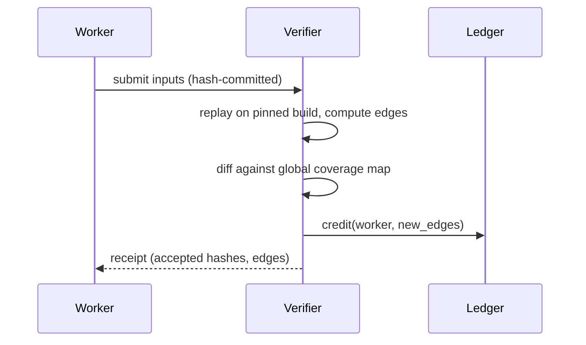

# Verifiable Security Work

How can someone prove they did security work they claim? This is the central question for any open market in security compute.

## A ladder of verifiability

| Level | Claim | Proof |
|---|---|---|
| 1 | "I found a crash" | the input; anyone replays it |
| 2 | "this corpus reaches N edges" | the corpus; recompute coverage (cost ∝ corpus size, not campaign time) |
| 3 | "this input violates invariant P on fork at block B" | Foundry test; deterministic replay |
| 4 | "I ran T hours of fuzzing" | weak: only statistical or hardware attestation |
| 5 | "property P holds for all inputs" | a formal proof certificate, or trust in the prover |

Design markets around levels 1–3 and avoid paying for level 4 claims without attestation.

## Proof-of-coverage

Instead of paying for time, pay for **new coverage contributed**: a worker submits inputs, and a verifier replays them and rewards those that add edges to the global map. Properties:

- Cheap verification relative to discovery.
- Rewards diminish naturally as the target saturates.
- Incentive problem: workers may hold back inputs to release slowly. Mitigate with first-submitter rewards and decaying payouts over time.

Two details make or break the scheme:

1. **The verifier's build defines "coverage".** Use one pinned, reproducible instrumented build. Different compilers or flags yield different edge IDs.
2. **Edges are not equal.** An edge in error-handling boilerplate is worth less than one in a rarely reached parser state. Simple systems pay per edge; better ones weight edges by how many workers have already hit them (rarity), similar to how AFL++'s `rare` schedule prioritises.



## Deterministic replay and spot checks

If the fuzzer is deterministic given a seed (LibAFL can be configured this way), the coordinator can assign `(target, config, rng_seed, duration_in_execs)` and later **re-run a random 1% of jobs** to compare the resulting corpus hashes. Cheating is caught with probability proportional to the spot-check rate. Combined with a slashed stake, that is enough deterrence (the TrueBit verification-game idea, simplified).

Determinism is harder than it looks. Sources of non-determinism include timeouts (wall-clock dependent), multi-threaded targets, address-space randomisation affecting hash maps inside the target, and calibration stages that measure timing. Measure duration in executions, not seconds, disable timing-based heuristics, and run single-threaded targets.

## Hardware attestation

TEEs (Chapter 5) can attest that a specific binary ran with specific inputs. That makes level-4 claims checkable as long as you trust the hardware vendor and the TEE has no exploitable side channel.

## Zero-knowledge proofs

zkVMs (RISC Zero, SP1, and others) can prove that a program ran on inputs and produced outputs. For security work:

- **Feasible:** prove a property of a *single* execution, such as "this input crashes this parser", without revealing the input. That enables "proof of exploit without disclosure" for bounty negotiations.
- **Not feasible (yet):** proving long fuzz campaigns. Proving overhead is orders of magnitude above native execution.

"Proving a vulnerability exists without revealing it" is a research area worth watching: it changes the power balance between finders and vendors in bounty disputes. Note what such a proof does not show: that the bug is exploitable in production, or that the guest program faithfully models the real target.

## Worked example

> **Execution status:** The Part A table is hand-computed arithmetic. The Part B commands and script were not executed in this book's CI; verify locally.

A spot-check deterrence model, then a proof-of-coverage verifier you can run locally.

**Part A: how much checking is enough?** Let a cheater save cost `g` per job by not working, risk a slashed stake `S` if caught, and let the spot-check probability be `p`. Cheating is unprofitable when `p × S > g`.

| Job value `g` | Stake `S` | Minimum `p` |
|---|---|---|
| 1 unit | 100 units | 1% |
| 1 unit | 20 units | 5% |
| 5 units | 100 units | 5% |

Re-running 5% of jobs costs the network 5% overhead. Raising stakes lowers the required overhead but raises the barrier to joining. That trade-off is the dial you tune.

**Part B: a coverage verifier using `afl-showmap`.** Build the target with AFL++ instrumentation, then for each submitted input record the edges it hits:

```bash
mkdir -p maps
for f in submission/*; do
  afl-showmap -q -t 500 -o "maps/$(basename "$f").map" -- ./target "$f"
done
```

Each `.map` file lists `edge_id:hitcount_bucket` lines. A short Python script computes what is new:

```python
import glob
known = set(open("global.edges").read().split()) if glob.glob("global.edges") else set()
credit = {}
for m in sorted(glob.glob("maps/*.map")):
    edges = {line.split(":")[0] for line in open(m)}
    new = edges - known
    credit[m] = len(new)
    known |= new
open("global.edges", "w").write("\n".join(sorted(known)))
for m, n in credit.items():
    print(f"{m}: {n} new edges")
```

Expected output: the first inputs earn many edges, later ones fewer, and duplicates earn zero. Run it twice on the same submission and the second run credits nothing, which shows why replays of old inputs cannot be paid twice.

## Common pitfalls

- **Paying per input rather than per new edge.** Workers then submit thousands of trivial mutations.
- **Letting workers choose their own seed.** A worker can grind seeds offline until one looks productive, then claim it.
- **Using wall-clock duration in deterministic jobs.** Timing differences between machines make honest re-runs diverge, producing false accusations.
- **Forgetting hit-count buckets.** Two inputs can hit the same edges with different counts; decide whether that counts as new.
- **Overselling zk proofs.** A proof of a crash in a guest program is only as meaningful as the guest's fidelity to the real target.

## Exercises

1. Implement proof-of-coverage rewards: a verifier that replays submitted inputs against a coverage-instrumented target and computes new edges.
2. Configure a deterministic LibAFL run and show that two runs with the same seed produce the same corpus hash.
3. Write a zkVM guest program that parses an input with a small parser and commits "crashed: true/false". Measure proving time.
4. Extend the Part A table with a cost for false accusations caused by non-determinism. How does it change the best `p`?

## Further reading

- TrueBit whitepaper: <https://people.cs.uchicago.edu/~teutsch/papers/truebit.pdf>
- RISC Zero: <https://dev.risczero.com>; SP1: <https://docs.succinct.xyz>
- AFL++ `afl-showmap` and `afl-cmin` documentation: <https://aflplus.plus/docs/>
- Green, Kaptchuk et al. have written on zero-knowledge proofs of exploits; search "zero-knowledge proof of vulnerability" for the current state of research
