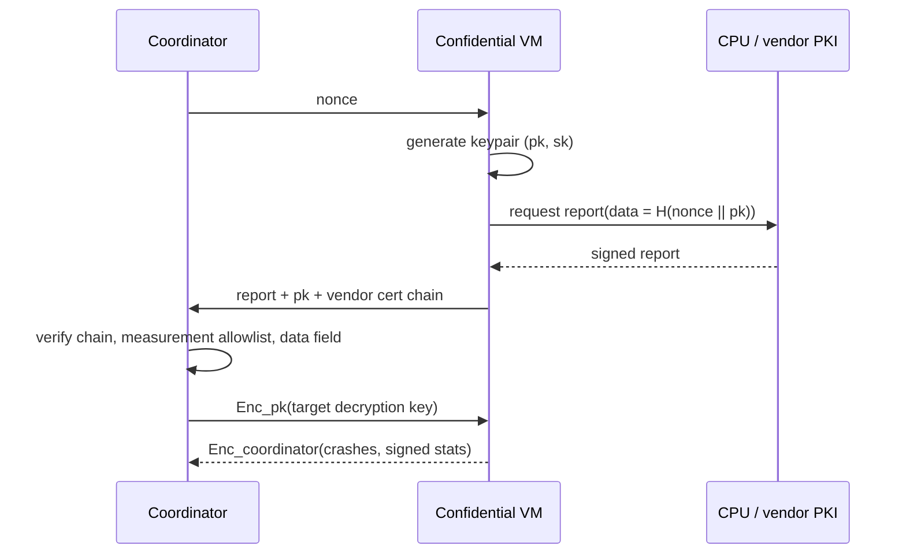

# TEEs for Confidential Security Compute

Trusted Execution Environments (TEEs) let code run in an enclave or confidential VM whose memory the host cannot read, and produce **remote attestation**: a signed statement of what code is running.

## Options

| Technology | Granularity | Notes |
|---|---|---|
| Intel SGX | process enclaves | small memory historically; long history of side-channel research |
| Intel TDX | confidential VMs | runs a whole VM; easier to port tools |
| AMD SEV-SNP | confidential VMs | broadly available in clouds |
| Arm CCA | realms | emerging |
| NVIDIA confidential computing (H100+) | GPU | for confidential model inference |

Several blockchain projects build on TEEs (for example Phala Network, Oasis Sapphire, Secret Network, and TEE-based coprocessors), and you can rent confidential VMs from major clouds.

For porting security tools, confidential VMs are far easier than SGX enclaves. AFL++, a sanitizer build and a Python driver run unmodified inside a TDX or SEV-SNP guest. SGX requires either rewriting around the enclave boundary or a library OS such as Gramine, with a manifest listing every trusted file.

## Use cases in security

1. **Confidential fuzzing of private code** on untrusted hardware: the code and crashes stay inside the TEE; only encrypted results leave.
2. **Sealed vulnerability escrow**: a finder submits a PoC to an enclave that checks it against the target and releases a "valid: severity X" attestation to the vendor without revealing details until payment. This has to be designed carefully, since a validity oracle can itself leak information.
3. **Confidential AI analysis**: running a model over private code without the infrastructure provider seeing it.
4. **Attested scanners**: a published scanner binary whose attestation proves which version and rules produced a "clean" report.

## What attestation actually binds

A confidential-VM attestation report contains, among other fields, a **measurement** (a hash of the initial guest memory: firmware, and depending on configuration the kernel, initrd and command line) and a **report data** field of 64 bytes chosen by the guest. The hardware signs both.

The report says nothing about what happened *after* boot unless the boot chain measures it. If your fuzz worker downloads a target after boot, the measurement does not cover that target. Practical consequences:

- Put the worker's code in the measured image, or extend measurements at runtime (TDX runtime measurement registers, vTPM PCRs).
- Put a hash of the worker's ephemeral public key into report data, so the coordinator encrypts the target key to *this* VM and not to a host that replays an old report.
- Include a fresh nonce from the coordinator to prevent replay.



## Limits you must state honestly

- **Side channels:** SGX has had many published attacks (Foreshadow, Plundervolt, SGAxe, ÆPIC Leak and more). Confidential VMs have their own attack research. TEEs raise the cost; they do not eliminate risk.
- **Vendor trust:** attestation roots chain to the CPU vendor.
- **Availability:** the host can always refuse service.
- **Bugs inside the enclave** are still bugs: attestation proves *which* code ran, not that it is correct.
- **Debug mode:** a guest launched with debug policy lets the host read its memory. Verifiers must reject reports with the debug flag set.

See **TEE Attack Engineering** for a full treatment of these attacks and attestation mistakes.

## Worked example

> **Execution status:** Not executed in this book's CI; verify locally. Outputs described as "expected" are what the tools should show, not observed results. Requires SEV-SNP or TDX hardware.

Fetch and inspect an attestation report from inside a confidential VM. You need a VM on SEV-SNP or TDX hardware; several major clouds offer them. Linux 6.7 and later expose a vendor-neutral interface called configfs-tsm.

**Step 1: request a report with your own 64 bytes of report data.**

```bash
sudo mount -t configfs none /sys/kernel/config 2>/dev/null
R=/sys/kernel/config/tsm/report/r0
sudo mkdir $R
# 64 bytes: in a real flow, SHA-512(nonce || public key)
head -c 64 /dev/urandom | sudo tee $R/inblob > /dev/null
sudo cat $R/provider          # e.g. sev_guest or tdx_guest
sudo cat $R/outblob > report.bin
ls -l report.bin
```

The `provider` file tells you which TEE backend answered. `outblob` is the raw signed report (an SNP report, or a TDX quote, depending on platform).

**Step 2: verify it.** On SEV-SNP, the VirTEE `snpguest` tool can fetch AMD's certificate chain and check the signature. Typical usage looks like:

```bash
snpguest fetch ca pem ./certs <processor-model>
snpguest fetch vcek pem ./certs report.bin
snpguest verify certs ./certs
snpguest verify attestation ./certs report.bin
snpguest display report report.bin
```

Subcommand arguments have changed between releases, so check `snpguest --help` for your version. In the displayed report, look at the measurement, the policy (is debug allowed?) and the report data you supplied.

**Step 3: decide.** Your coordinator should accept only if the signature chains to the vendor root, the measurement is on an allowlist built from your reproducible image, debug is off, the TCB version meets your minimum, and report data matches the nonce and key you expect.

## Common pitfalls

- **Checking the signature but not the measurement.** A valid report from any VM on genuine hardware proves nothing about your code.
- **No freshness.** Without a nonce in report data, a host can replay an old report from a VM it has since tampered with.
- **Measuring the bootloader but not the workload.** Code fetched after boot is outside the measurement.
- **Accepting outdated TCB levels.** Firmware updates fix known flaws; old TCB versions still produce validly signed reports.
- **Leaking via outputs.** Crash counts, timing and output size can reveal information about a confidential target even when contents are encrypted.

## Exercises

1. Launch an AMD SEV-SNP or Intel TDX confidential VM on a cloud provider and fetch its attestation report.
2. Implement key release: the coordinator sends the decryption key only after verifying the measurement.
3. Write a threat model for "sealed vulnerability escrow". What can the vendor learn from repeated queries?
4. Build two images that differ by one byte in the initrd. Confirm the measurements differ and your allowlist rejects one.

## Further reading

- Intel TDX: <https://www.intel.com/content/www/us/en/developer/tools/trust-domain-extensions/overview.html>
- AMD SEV-SNP: <https://www.amd.com/en/developer/sev.html>
- VirTEE `snpguest`: <https://github.com/virtee/snpguest>
- Gramine library OS: <https://gramine.readthedocs.io>
- Confidential Computing Consortium: <https://confidentialcomputing.io>
- Van Bulck et al., "Foreshadow", USENIX Security 2018
- Phala Network docs: <https://docs.phala.network>
