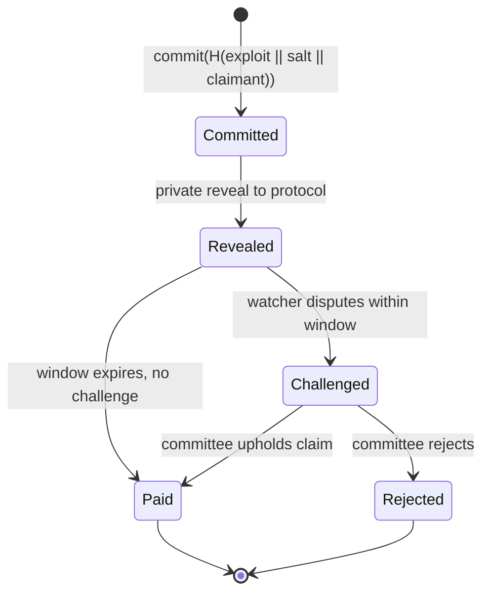

# Crypto-Economic Coordination for Security

Blockchains can pay for security work automatically, conditional on verifiable results. This chapter reviews mechanisms that exist and designs that are still open. Project designs in this space change often; describe mechanisms to yourself, then check each project's current documentation before relying on it.

## Existing mechanisms

- **Bug bounty platforms with on-chain payouts** (e.g. Immunefi). Off-chain judging, on-chain payment.
- **Audit coverage/insurance** models: Sherlock historically paired audit contests with coverage backed by stakers.
- **Detection networks with staking:** Forta's model of detection bots run by node operators with stake.
- **Restaking-based services:** EigenLayer and similar systems let services ("AVSs") borrow economic security from restaked ETH. Some are security-related (monitoring, oracles, bridges' verification). Note the risk: shared stake means shared failure. **Restaking and Shared Security Risk** covers this in depth.
- **On-chain exploit bounties via "proof of exploit" escrow** remain mostly experimental.

| Mechanism | What is verified on-chain | What stays off-chain | Main trust assumption |
|---|---|---|---|
| Bounty platform payout | payment only | validity, severity | platform and project judges |
| Audit contest | payment only | judging, deduplication | judges and escalation process |
| Staked detection network | stake, rewards | alert quality | reputation or committee review |
| Conditional bounty (this chapter) | claim, commitment, challenge | exploit details until reveal | watchers who challenge false claims |

## Designing a conditional bounty contract

Idea: a protocol escrows a reward that pays out to anyone who submits a transaction sequence violating a published invariant **on a fork**. Challenges:

| Challenge | Mitigation |
|---|---|
| On-chain verification of a fork simulation is expensive | optimistic: claim + challenge window, verified off-chain by watchers; or zk proof of EVM execution |
| Submitting the exploit reveals it | commit–reveal: commit hash first, reveal privately to protocol, public reveal after fix |
| Front-running of the claim | commit includes claimant address; reveal must match |
| Invariant poorly specified | pay only for violations of *named* properties; scope disputes go to a human committee |



## Incentive pitfalls

- **Pay per hour** → idling. **Pay per bug** → hoarding and splitting one bug into many reports.
- **Duplicates:** first-come wins encourages rushing; split payouts encourage collusion (submit the same bug from many accounts). Contest platforms have spent years tuning these rules; learn from them.
- **Stake slashing** must be objective, or it becomes governance theatre.

## Open research questions

1. Can coverage-based rewards (Chapter 4) attract enough workers to matter for open-source projects?
2. Can zk proofs of EVM execution make on-chain exploit verification practical?
3. How do you prevent workers from **selling** findings to attackers instead of claiming bounties? (Bounty size vs black-market value is the honest answer.)

## Worked example

> **Execution status:** The Solidity contract and Foundry test were not executed in this book's CI; verify locally with `forge test`. The duplicate-payout numbers in Step 3 are hand-computed.

Build the commit phase of a conditional bounty in Foundry and test front-running resistance on a local chain.

**Step 1: the contract core.**

```solidity
// SPDX-License-Identifier: MIT
pragma solidity ^0.8.24;

contract CommitBounty {
    struct Claim { address claimant; uint64 committedAt; bool revealed; }
    mapping(bytes32 => Claim) public claims;
    uint64 public constant WINDOW = 3 days;

    function commit(bytes32 h) external {
        require(claims[h].claimant == address(0), "taken");
        claims[h] = Claim(msg.sender, uint64(block.timestamp), false);
    }

    // reveal is checked against the committing address
    function reveal(bytes calldata exploitRef, bytes32 salt) external {
        bytes32 h = keccak256(abi.encode(exploitRef, salt, msg.sender));
        Claim storage c = claims[h];
        require(c.claimant == msg.sender, "no commit");
        c.revealed = true;
    }
}
```

`exploitRef` would be an encrypted blob or a hash of the private report, not the exploit itself.

**Step 2: the front-running test.**

```solidity
function test_frontrunnerCannotReveal() public {
    bytes memory ref = "report-hash";
    bytes32 salt = keccak256("s");
    vm.prank(alice);
    bounty.commit(keccak256(abi.encode(ref, salt, alice)));
    vm.prank(mallory);               // mallory copies alice's reveal calldata
    vm.expectRevert("no commit");
    bounty.reveal(ref, salt);
}
```

Run `forge test -vv`. Expected: the test passes, because Mallory's address changes the hash. Then try the variant where `msg.sender` is *not* bound into the hash and watch the test fail. That one-line difference is the whole front-running defence.

**Step 3: a numeric check on duplicates.** Suppose a pot of 100 units, a bug found independently by one honest finder, and a split-payout rule ("divide equally among valid duplicates"). If the finder submits from 4 accounts, they receive 100 rather than 100/5 = 20 when one other honest finder also reports. Split rules therefore need identity or stake per submission, or a first-valid-wins rule with a short grace window.

## Common pitfalls

- **Putting exploit details in calldata.** Mempools and block explorers publish them. Commit hashes and encrypted references only.
- **Subjective slashing conditions.** "Low-quality alerts" cannot be enforced by code and invites governance fights.
- **Reward pots smaller than the exploit value.** A rational finder with no ethics compares them; keep pots meaningful.
- **No upgrade or pause plan for the bounty contract itself.** It holds funds and is a target.
- **Ignoring legal context.** Paying anonymous finders and defining safe-harbour terms are legal questions, not only code.

## Exercises

1. Write the commit–reveal bounty contract in Solidity with a challenge window. Write a threat model.
2. Simulate payout rules for duplicates with 10 agents and compare collusion incentives.
3. Survey three security-related AVSs or staking networks and identify what is slashable.
4. Extend the Foundry test with `vm.warp` to show a reveal after the window is rejected.

## Further reading

- Forta: <https://docs.forta.network>
- EigenLayer docs: <https://docs.eigenlayer.xyz>
- Sherlock: <https://docs.sherlock.xyz>
- Immunefi: <https://immunefi.com>
- Foundry book: <https://book.getfoundry.sh>
- Optimistic rollup fraud-proof designs as a model for challenge games (e.g. Arbitrum BoLD): <https://docs.arbitrum.io>
