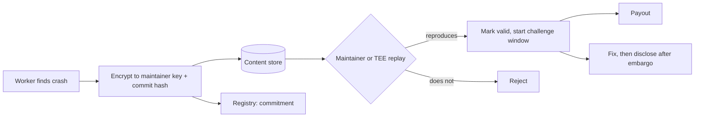

# Reference Architecture: An Open Security Compute Network

This chapter combines the book into one design document you can critique, fork or build.

## Goals

1. Continuous fuzzing and differential testing of open-source and Web3 infrastructure.
2. Contributions from anyone with spare compute.
3. Rewards for **verified** contributions only.
4. Private disclosure of findings to maintainers.

Non-goals matter as much: this design does not try to fuzz private code on anonymous hardware without a TEE, and it does not pay for unverifiable effort.

## Components

```
                 ┌────────────── Registry (on-chain) ──────────────┐
                 │ targets, configs, binary hashes, reward pools    │
                 └───────────────▲────────────────────▲─────────────┘
                                 │                    │
┌──────────────┐  tasks   ┌──────┴──────┐   claims   ┌┴────────────────┐
│ Workers      │◄─────────│ Coordinator │◄───────────│ Verifiers        │
│ (untrusted)  │──────────►  (open src) │───────────►│ (staked, replay) │
└──────┬───────┘ corpora, └──────┬──────┘  results   └────────┬────────┘
       │         crashes         │                            │
       ▼                         ▼                            ▼
 Content-addressed store   Disclosure vault (TEE or       Payouts (on-chain,
 (public corpora)          trusted maintainers' keys)     after challenge window)
```

| Component | Trust level | Can it lose funds? | Can it leak findings? | Replaceable? |
|---|---|---|---|---|
| Registry | public, on-chain | yes, if buggy | no | by migration |
| Coordinator | semi-trusted, open source | no (does not hold funds) | yes, if it sees plaintext crashes | yes, stateless design |
| Workers | untrusted | no | only what they find themselves | yes |
| Verifiers | staked | no | only inside TEE or maintainer-run | yes |
| Disclosure vault | trusted or attested | no | that is its purpose | maintainers choose |

## Flows

1. **Register target:** maintainers (or sponsors) register a repo, build recipe, harnesses and reward pool. The build is reproducible, and the hash is recorded.
2. **Fuzz:** workers pull tasks, sync corpora to the content store, and submit new-coverage inputs.
3. **Verify:** staked verifiers replay inputs. Coverage rewards accrue per new edge.
4. **Crash:** crashes are **encrypted to maintainers' keys** before upload. Verifiers check them inside a TEE or via maintainer-run replay, then mark them valid. Reward after a challenge window.
5. **Disclose:** standard 90-day policy unless maintainers agree otherwise.



## Security of the network itself

- Malicious harness/build recipes could attack workers → workers run tasks in sandboxes (gVisor, Firecracker, or bubblewrap with no network).
- Corpus poisoning → verifier recomputation with resource caps.
- Sybil verifiers → stake plus random assignment.
- Front-running crash rewards → encrypted submission with claimant binding.
- Coordinator compromise → keep it stateless and unable to decrypt crashes; workers check task signatures against the registry so a rogue coordinator cannot push arbitrary build recipes.

## Minimum viable version (no blockchain)

Start with a coordinator, an S3-compatible store and a manual payout list. Add on-chain components only when the off-chain version shows real demand. Most failed "decentralised X" projects decentralised first and found users never.

## Worked example

> **Execution status:** Not executed in this book's CI; verify locally. Outputs described as "expected" are what the tools should show, not observed results.

Build the MVP for one target on one machine with three "workers", using only open-source tools.

**Step 1: a content-addressed store.** MinIO gives you an S3-compatible bucket locally.

```bash
docker run -d -p 9000:9000 -p 9001:9001 --name store \
  -e MINIO_ROOT_USER=dev -e MINIO_ROOT_PASSWORD=devdevdev \
  minio/minio server /data --console-address :9001
mc alias set local http://127.0.0.1:9000 dev devdevdev
mc mb local/corpus && mc mb local/crashes
```

**Step 2: a worker loop.** Each worker uploads new queue entries named by hash, and crashes encrypted to the maintainer's public key with `age`.

```bash
while true; do
  for f in out/w1/queue/id:*; do
    h=$(sha256sum "$f" | cut -c1-64)
    mc cp -q "$f" "local/corpus/$h" >/dev/null
  done
  for f in out/w1/crashes/id:*; do
    [ -e "$f" ] || continue
    h=$(sha256sum "$f" | cut -c1-64)
    age -r "$MAINTAINER_AGE_PUBKEY" -o "/tmp/$h.age" "$f"
    mc cp -q "/tmp/$h.age" "local/crashes/$h.age" >/dev/null
  done
  sleep 300
done
```

Run the fuzzer itself inside a sandbox with no network; only this upload loop talks to the store.

**Step 3: a verifier.** The maintainer decrypts and replays:

```bash
mc cp --recursive local/crashes/ inbox/
for f in inbox/*.age; do
  age -d -i maintainer.key -o "${f%.age}" "$f"
  timeout 5 ./target "${f%.age}" >/dev/null 2>&1; echo "$f exit=$?"
done
```

A non-zero exit with a sanitizer report is a valid claim. Record `(hash, worker, valid)` in a CSV. That CSV is the payout list.

**Step 4: measure.** After a week, count accepted coverage inputs and valid crashes per worker. If nobody outside your friends wants to contribute or receive findings, you have learned that cheaply, without deploying a contract.

## Common pitfalls

- **The coordinator sees plaintext crashes.** Encrypt at the worker, before upload.
- **Build recipes as arbitrary shell scripts.** A malicious sponsor can attack every worker. Sandbox builds as strictly as fuzzing.
- **On-chain registry with no migration path.** Targets, keys and policies change; plan upgrades and key rotation.
- **One verifier.** A single verifier is a single point of failure and bribery.
- **Unclear disclosure ownership.** Decide who notifies maintainers, who sets embargoes and who can extend them before the first crash arrives.

## Exercises

1. Pick one component and write its API (OpenAPI or protobuf).
2. Write the threat model for the coordinator. What happens if it is compromised?
3. Build the MVP for one open-source target and run it with three friends' machines for a week.
4. Replace the CSV payout list with a minimal contract on a local Anvil chain. What new failure modes appear?

## Further reading

- Firecracker: <https://firecracker-microvm.github.io>
- gVisor: <https://gvisor.dev>
- bubblewrap: <https://github.com/containers/bubblewrap>
- age encryption tool: <https://github.com/FiloSottile/age>
- MinIO: <https://min.io/docs/minio/linux/index.html>
- Google Project Zero disclosure policy: <https://googleprojectzero.blogspot.com/p/vulnerability-disclosure-policy.html>
- All earlier chapters' references.
